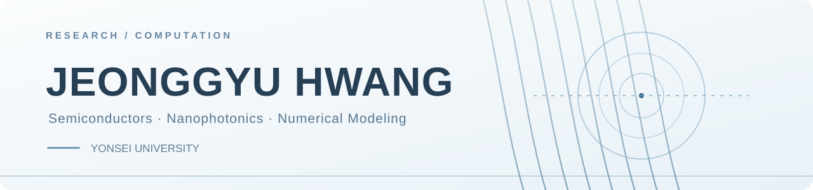

<!-- Research Minimal: Developer-JG -->

  

<h3 align="center">Jeonggyu Hwang · 황정규</h3>

  M.S.–Ph.D. Integrated Student in Electrical & Electronic Engineering 
  Yonsei University · Seoul, South Korea

  
  
  

---

### About

I explore the intersection of **semiconductor devices, nanophotonics, and scientific computing**. My work involves numerical modeling and device-oriented research, with an interest in connecting theoretical predictions to practical designs.

- **Research interests** · Phase-change materials (VO₂), reconfigurable photonics, optical metamaterials, hyperlenses
- **Computational work** · Numerical simulation, optimization, scientific data analysis
- **Tools** · Python, NumPy, pandas, Matplotlib, Git

### Research Focus

| Area | Questions I explore |
| :-- | :-- |
| **Reconfigurable nanophotonics** | How can tunable materials change the optical response of subwavelength structures? |
| **Hyperlens & optical simulation** | How can multilayer designs transfer fine spatial information while accounting for losses and fabrication limits? |
| **Semiconductor devices** | How can materials and interfaces enable useful switching behavior? |

### GitHub Snapshot

  
  

<b>Contribution animation</b>

 

  <picture>
    <source media="(prefers-color-scheme: dark)" srcset="https://raw.githubusercontent.com/Developer-JG/Developer-JG/output/github-contribution-grid-snake-dark.svg" />
    
  </picture>

Research · Simulate · Build · Refine

